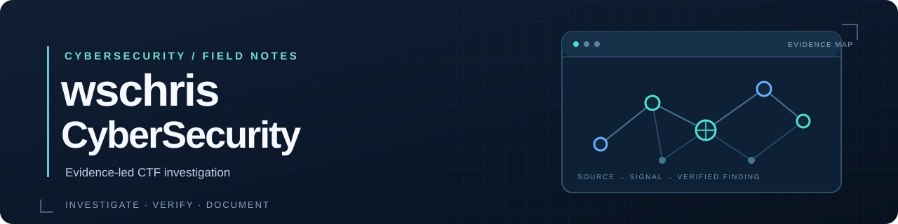

<p align="center">
  
</p>

<p align="center">
  <strong>Investigate carefully. Verify the evidence. Share the method.</strong><br>
  wschris CyberSecurity is a public field guide for cybersecurity challenges and reproducible CTF research.
</p>

<p align="center">
  <a href="docs/challenges.md"><strong>Explore 38 challenges</strong></a> ·
  <a href="tools/README.md"><strong>Use 18 tools</strong></a> ·
  <a href="docs/README.md"><strong>Read 6 playbooks</strong></a>
</p>

<p align="center">
  <a href="https://github.com/wschris1/wschris-CyberSecurity/actions/workflows/check-challenges.yml"></a>
</p>

---

## Find a challenge

The library pairs each prompt with an investigation guide. Guides explain the evidence to inspect, how to check a result, and what remains unresolved.

| Area | Guides | Start here |
| --- | ---: | --- |
| [Network, services & logs](docs/challenges.md#network-services-and-logs) | 7 | Service identification, packet captures, access logs |
| [Encoding, crypto & passwords](docs/challenges.md#encoding-cryptography-and-passwords) | 13 | Ciphers, encrypted files, hashes, candidate testing |
| [Web & browser evidence](docs/challenges.md#web-and-browser-evidence) | 6 | Browser history, authentication, authorized web labs |
| [Files, images & reversing](docs/challenges.md#files-images-and-reverse-engineering) | 6 | Binary files, images, bytecode, storage media |
| [OSINT & research](docs/challenges.md#osint-and-research) | 6 | Maps, historical records, public sources |

**[Browse the complete challenge library →](docs/challenges.md)**

## Start an investigation

1. **Read the full prompt.** Record the exact questions, formats, constraints, and authorized scope.
2. **Preserve the evidence.** Keep original artifacts and private working notes outside this repository. Start with the [CTF investigation playbook](docs/ctf-playbook.md).
3. **Choose a narrow tool.** Use the [tool catalog](tools/README.md) and the relevant [skill playbook](docs/README.md).
4. **Verify before writing.** Check a candidate against the original evidence using the [verification checklist](docs/verification-checklist.md).
5. **Publish the method.** Document reproducible steps and limits without publishing final responses or recovered credentials.

### Local quick start

The helpers require Python 3.10 or later and use the standard library. Run from the repository root, replacing the example path with a private working directory outside this checkout.

```bash
python3 tools/environment_report.py --no-version
python3 tools/artifact_inventory.py --json /private/work/challenge
python3 tools/safe_extract.py /private/work/challenge/input.zip
```

Read each helper's `--help` before using it. The [tool catalog](tools/README.md) explains inputs, limits, and exit codes.

## Featured field notes

| Investigation | Technique |
| --- | --- |
| [Service Enumeration](challenges/service-enumeration/how-to-solve.md) | Separate port discovery from protocol and banner evidence |
| [Cyber Command](challenges/cyber-command/how-to-solve.md) | Inspect TLS authentication traffic and distinguish extraction from recovery |
| [Browser History Investigation](challenges/browser-history-investigation/how-to-solve.md) | Query visit records and validate timestamp conversions |
| [Encrypted SQLite Backup](challenges/encrypted-sqlite-backup/how-to-solve.md) | Identify an encrypted format and verify candidate keys |
| [Remote Desktop Bitmap Cache](challenges/remote-desktop-bitmap-cache/how-to-solve.md) | Reconstruct image records and correlate session metadata |

The full library includes both completed methods and open investigations. Each guide states its own status and limits.

## Repository map

```text
challenges/   Question and method guide for each challenge
docs/         Investigation workflow, checklists, and playbooks
tools/        18 dependency-free command-line helpers
tests/        Tests for tools and publication checks
assets/       README artwork
```

## Contribute

Start with [repository instructions](AGENTS.md) and scaffold a question/guide pair:

```bash
python3 tools/new_challenge.py example-challenge "Example challenge"
```

A challenge folder contains `question.md` and `how-to-solve.md`; `question.png` is optional. Keep captures, databases, key logs, decrypted output, screenshots containing responses, flags, and credentials outside the repository. Public guides contain methods and verification steps.

Before committing, review the entire diff and run:

```bash
python3 .github/scripts/check_challenges.py
python3 -m unittest discover -s tests -v
git diff --check
```

GitHub Actions runs the content check and tests on Python 3.10 and 3.12. The automated leak check supports manual review; it cannot recognize every answer-bearing detail.

<sub>[AI investigation workflow](docs/ai-workflow.md) · [Terminal troubleshooting](docs/terminal-workflow.md) · [Verification checklist](docs/verification-checklist.md) · [Private handoff template](docs/investigation-notes-template.md)</sub>
