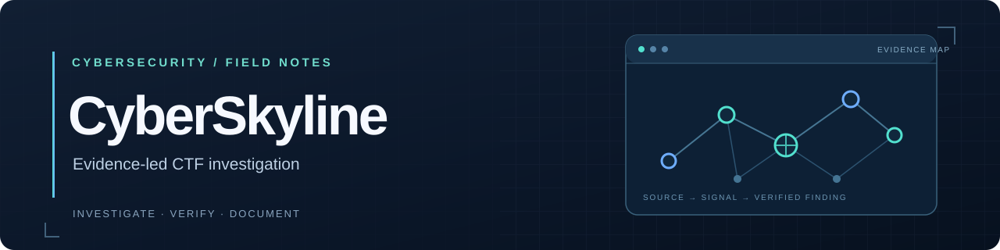

<p align="center">
  
</p>

<p align="center">
  <a href="https://github.com/wschris1/CyberSkyline/actions/workflows/check-challenges.yml"></a>
  <a href="tools/README.md">18 Python tools</a> ·
  <a href="docs/challenges.md">38 challenge guides</a> ·
  <a href="docs/README.md">6 skill playbooks</a>
</p>

A practical CTF notebook for people and AI assistants: investigate artifacts, test hypotheses, verify evidence, and write reproducible methods. **Public guides contain methods, not final answers or recovered credentials.**

## Choose your starting point

| I want to… | Start here |
| --- | --- |
| Investigate a new challenge | [CTF playbook](docs/ctf-playbook.md) |
| Find a command-line helper | [Tool catalog and recipes](tools/README.md) |
| Continue with an AI assistant | [AI workflow](docs/ai-workflow.md) · [Repository instructions](AGENTS.md) |
| Fix a terminal or permissions problem | [Terminal workflow](docs/terminal-workflow.md) |
| Double-check a result | [Verification checklist](docs/verification-checklist.md) |
| Resume without repeating failed attempts | [Private handoff template](docs/investigation-notes-template.md) |

## Quick start

Use Python 3.10 or later. The included helpers use the standard library; no pip dependencies are required. Run commands from the repository root and substitute your own **private working directory outside this checkout**.

```bash
python3 tools/environment_report.py --no-version
python3 tools/artifact_inventory.py --json /private/work/challenge
python3 tools/safe_extract.py /private/work/challenge/input.zip
```

Inspect a helper's `--help` before using it. Output may contain challenge evidence even when a tool hides sensitive fields by default. Keep raw inputs and generated results private.

## Toolkit

| Area | Included helpers |
| --- | --- |
| **Setup & preservation** | [Environment report](tools/environment_report.py), [artifact inventory](tools/artifact_inventory.py), [archive validation and extraction](tools/safe_extract.py) |
| **Binary investigation** | [Strings with offsets](tools/strings_extract.py), [hex view](tools/hex_view.py), [binary comparison](tools/binary_diff.py), [entropy windows](tools/entropy_scan.py), [embedded signatures](tools/signature_scan.py) |
| **Encoding & credentials** | [Explicit decoding](tools/decode_value.py), [repeating XOR](tools/xor_bytes.py), [candidate filtering](tools/candidate_filter.py), [SSH public-key structure and fingerprints](tools/ssh_public_key.py) |
| **Logs, web & timelines** | [JSONL schema and counts](tools/jsonl_summary.py), [SQLite inspection](tools/sqlite_inspect.py), [saved HTTP responses](tools/http_response_inspect.py), [URL inventory](tools/url_inventory.py), [timestamp conversion](tools/timestamp_convert.py) |
| **Writing** | [Challenge scaffold](tools/new_challenge.py) |

**[Browse examples, limits, and exit codes →](tools/README.md)**

## Skill playbooks

Read the matching playbook before choosing a tool. Each includes common mistakes and a way to check the result.

| Network & systems | Data & investigation |
| --- | --- |
| [Service enumeration](docs/skills/service-enumeration.md) | [Encoding, cryptography & passwords](docs/skills/encoding-crypto-passwords.md) |
| [SMB, SSH & compliance checks](docs/skills/smb-ssh-compliance.md) | [Files, images & reverse engineering](docs/skills/files-images-reversing.md) |
| [Packets, logs & timelines](docs/skills/packet-log-forensics.md) | [Web & OSINT](docs/skills/web-osint.md) |

These are readable repository guides, not automatically installed AI plugins. See the [skills index](docs/README.md) for suggested workflows.

## Challenge library

**[Browse all 38 challenges by category →](docs/challenges.md)**

| Guide | What it teaches |
| --- | --- |
| [Service enumeration](challenges/service-enumeration/how-to-solve.md) | Separate port discovery, protocol identification, and exact banner evidence |
| [Hercules compliance audit](challenges/hercules-compliance-audit/how-to-solve.md) | Trace SMB evidence, local profiles, remote accounts, and permission boundaries; investigation remains incomplete |
| [Unauthorized network services](challenges/unauthorized-network-services/how-to-solve.md) | Correlate Zeek records and assess exposed services |
| [Blurred messages](challenges/blurred-messages/how-to-solve.md) | Compare fonts and reproduce the image transformation |
| [Cyber Command](challenges/cyber-command/how-to-solve.md) | Decrypt TLS and inspect authentication evidence; password recovery remains incomplete |
| [Cyber Command: admin flag](challenges/cyber-command-admin-flag/how-to-solve.md) | Trace redirect, framing, and CSRF behavior in the supplied challenge |

## Contribute a method

Read [AGENTS.md](AGENTS.md), then create a skeleton:

```bash
python3 tools/new_challenge.py example-challenge "Example challenge"
```

Each challenge requires `question.md` and `how-to-solve.md`; an original prompt image may be included as `question.png`. Explain the observed method, verification, and unresolved work. Replace response-bearing values with descriptive placeholders.

`IMAGES/` accepts PNG, JPEG, GIF, WebP, and `.txt` inputs that meet the same publication rules. Review them before upload. Captures, databases, key logs, decrypted output, private notes, final answers, and scoring data stay outside the repository.

Run the checks and review the complete staged diff:

```bash
python3 .github/scripts/check_challenges.py
python3 -m unittest discover -s tests -v
git diff --check
git diff --cached --check
git diff --cached
```

GitHub Actions runs the content check and test suite. Automated detection catches selected leak patterns; manual review is still required for ordinary-looking facts, URLs, and images that answer a challenge.
